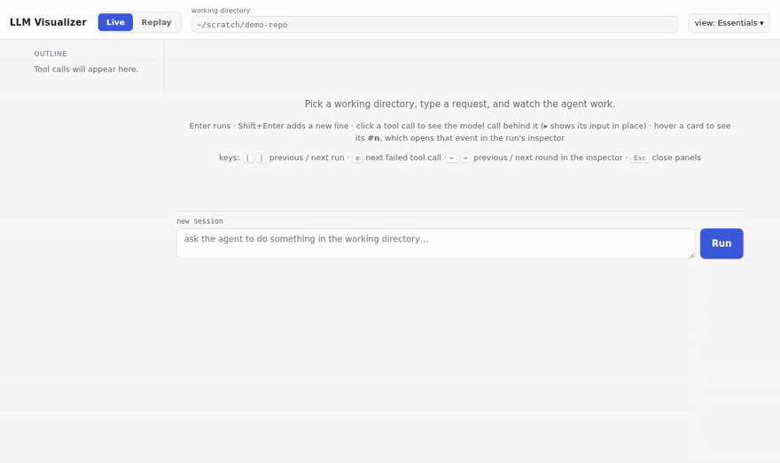

# LLM Visualizer

**Look inside your agent's head.** Watch every model call, tool call, subagent and context
change as it happens, or replay a recorded trace.



Agent logs are walls of JSON. LLM Visualizer turns them into something you can read. It drives
[Claude Code](https://docs.claude.com/en/docs/claude-code) headlessly and draws the run live. It
can also replay any `stream-json` trace, whether from Claude Code or from **your own agent harness**.

## Quick start

```bash
pip install -r requirements.txt
python server.py            # → http://127.0.0.1:8765
```

Switch to **Replay**, pick an example trace, and you're looking at a full agent run. No API key needed.

## What you get

- 🌳 **Subagents as a tree.** Parallel subagents fork into named branches (A, B, A.1…) and visibly join back.
- 💬 **The model's-eye view.** Each round is drawn as the exact conversation the model received,
  colour-coded by author: **LLM**, **harness** or **tool output**.
- 📉 **Context over time.** See how big each request was, and when old tool results were trimmed,
  cleared or compacted into a summary.
- ✅ **Verified, not guessed.** For harness traces, every rebuilt request is checked against a
  SHA-256 digest of what was really sent.
- ⏯️ **Live or replay.** Run a prompt against a directory, or drop a `.jsonl` onto the page and replay it at any speed.
- 🪶 **No build step.** FastAPI plus Preact + htm, with vendored dependencies. Clone and run.

## Using it

**Live mode** runs `claude -p` in the working directory you choose, using your stored Claude Code
login. `ANTHROPIC_API_KEY` is deliberately removed from the agent's environment. Point it at a scratch
directory, not your home directory.

**Replay mode** streams a recorded trace instead. Use it to debug a run after the fact, or to work on
the UI quickly and for free. Pick one of the `fixtures/` examples, or drag in your own file (it stays
in the browser and is never saved on the server). To record a trace:

```bash
claude -p "find the bug that makes test_parse fail and fix it" \
  --output-format stream-json --verbose --dangerously-skip-permissions > fixtures/my-run.jsonl
```

**Find your way around:**

- Click **inspect** on a run to open the inspector. It has four tabs: *Overview*, *Rounds* (chat or
  list layout), *Context* and *Events* (every raw event, searchable).
- Keys: `[` `]` switch runs, `e` jumps to the next failed tool call, `←` `→` step through rounds, `Esc` closes panels.
- **view ▾** in the header picks what the dialogue shows: *Essentials*, *Everything* or *Custom*.
- Each run can be downloaded as a `stream .jsonl`, which can be replayed later.

### Example traces

| file | shows |
|---|---|
| `sample-handmade.jsonl` | a small synthetic Claude Code stream with one subagent |
| `sample-parallel.jsonl` | two parallel subagents, then a third on its own |
| `harness_review_demo.jsonl` | every kind of harness action: refusals, nudges, a loop guard, a reviewer subagent that fails the fix |
| `harness_context_demo.jsonl` | context management: tool results trimmed, then cleared, then compacted |

### Configuration

All optional, set as environment variables:

| var | default | meaning |
|---|---|---|
| `PORT` / `HOST` | `8765` / `127.0.0.1` | where to listen |
| `DEFAULT_CWD` | empty | pre-filled working directory |
| `CLAUDE_PERMISSION_ARGS` | `--dangerously-skip-permissions` | e.g. `--allowedTools Edit Read "Bash(pytest:*)"` |
| `REPLAY_DELAY` | `0.12` | seconds between events at *Normal* replay speed |
| `ACCESS_TOKEN` | unset | require `?token=…` on every request (set it before exposing the server) |

## Bring your own harness

Building your own agent loop? Write a `.jsonl` file in Claude Code's `stream-json` shape (`system/init`,
`assistant`, `user`, `result`, linked by `tool_use_id` / `parent_tool_use_id`) and it renders as is.
Add any of these optional `system` events to unlock more of the UI:

| subtype | key fields | unlocks |
|---|---|---|
| `init` | `pruning`, `tool_schemas`, `resends_reasoning` | marks the file as a harness trace |
| `system_prompt` | `content` | the system prompt in the dialogue and chat view |
| `harness` | `action`, `text`, `tool_use_id` | ⚙ harness decisions: refusals, nudges, notes, reviews |
| `context` | `messages_sent`, `chars_sent`, `pruned`, `window`, `ledger` | the Context tab |
| `llm_request` | `digest`, `message_count`, optional `messages`, `purpose` | ✓ Exact verification |
| `request` | `purpose`, `messages`, `tool_schemas` | one-off calls (e.g. a summarizer) as their own rounds |
| `compact_boundary` | | compaction markers |

`digest` is the SHA-256 of the request's messages as canonical JSON: sorted keys and no spaces,
as Python's `json.dumps(..., sort_keys=True, separators=(",", ":"), ensure_ascii=False)` writes it.
`canonRequest` in `static/app.js` defines the exact shape. The `fixtures/harness_*.jsonl` files are
complete examples.

## How it works

- **`server.py`** (FastAPI): `POST /api/run` spawns `claude -p … --output-format stream-json --verbose`
  and streams stdout as NDJSON, or streams a trace file for a replay. `POST /api/runs/{id}/stop` and
  `POST /api/runs/{id}/replay` stop a run or pause and re-pace a replay.
- **`static/app.js`** (Preact + htm): builds a tree from `tool_use_id` / `parent_tool_use_id`, then
  renders the dialogue, outline and inspector.
- **`static/vendor/`**: pinned preact+htm 3.1.1, marked 12.0.2 and DOMPurify 3.1.6.
